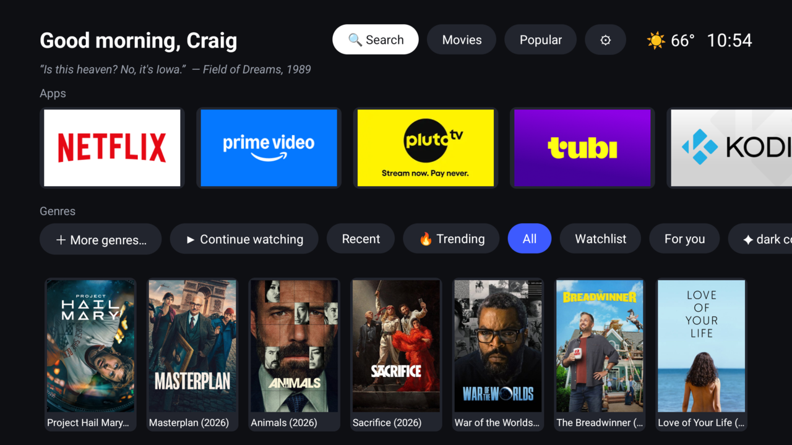
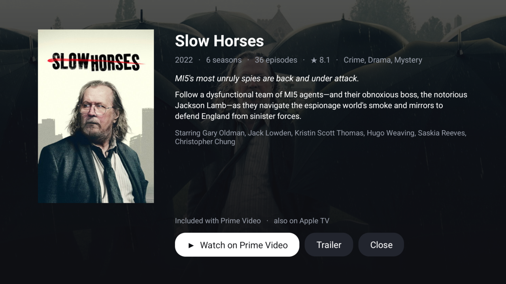
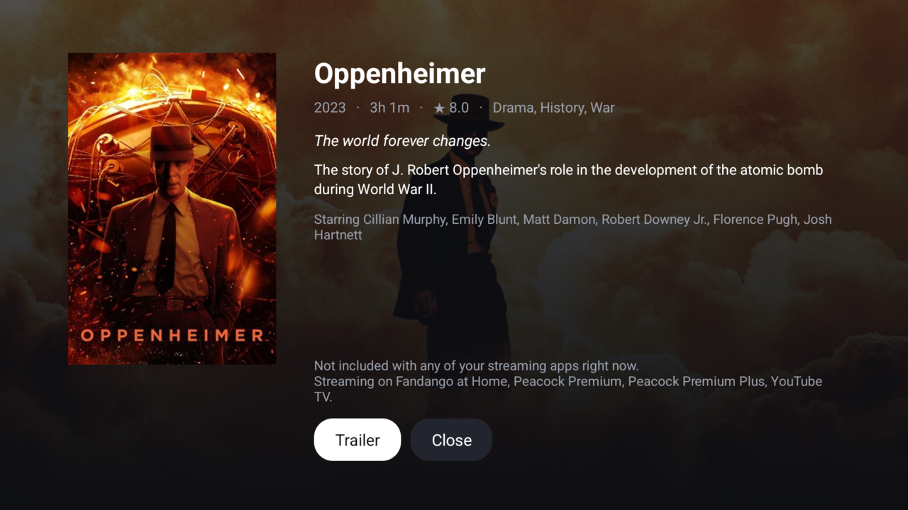
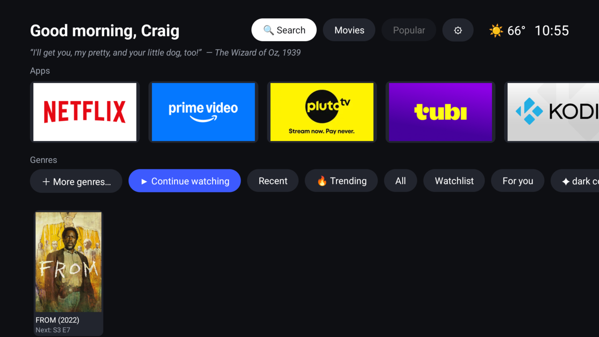
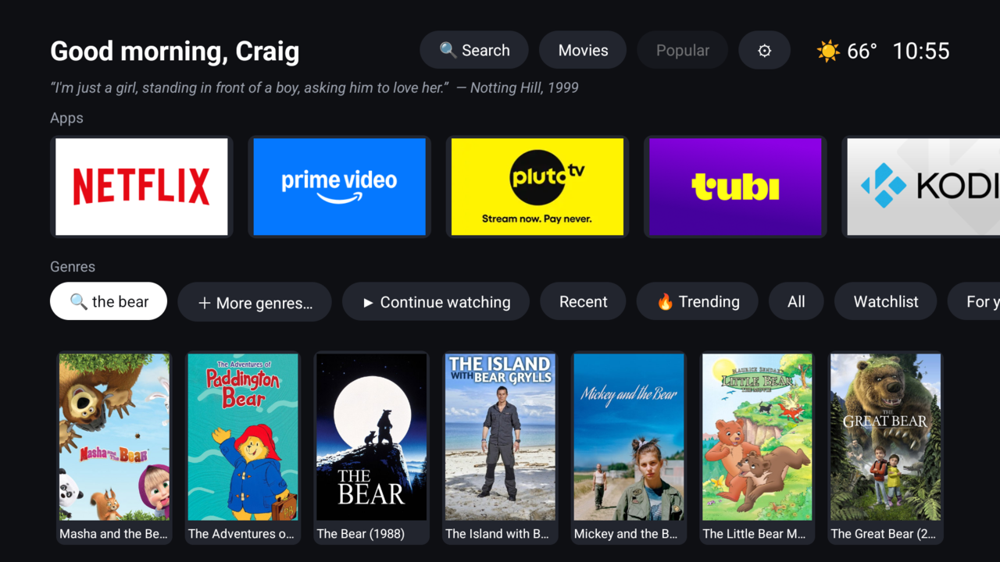

# Reel Launcher

A Google TV / Android TV home screen with an apps row and a genre browser that only shows titles streaming on the apps you actually have installed.



- **Greeting header**: "Good evening, Craig" by the clock (set your name in ⚙), with a movie line underneath that fades to a new one every 20 seconds: Casablanca to The Room.
- **Apps row**: every TV app. Long-press one for **Move** (slide it with ◀ ▶, OK to drop) or **Hide** (unhide from ⚙). Apps you haven't moved follow A–Z.
- **Genres row**: **▶ Continue watching** and **Recent**, **🔥 Trending** (this week on TMDB), **All**, your Trakt **Watchlist** and **For you** rows when Trakt is linked, TMDB's standard genres, your recent niche genres (✦), and **＋ More genres…** for 70+ niche picks (folk horror, giallo, neo-noir, time loop, mumblecore…) or a box to type any genre at all.
- **🔍 Search** in the header: movies and shows together, whatever the type toggle says. The last query keeps a chip for the session.
- **Movies / Shows** toggle and a **sort** button (Popular, Top rated, Newest) in the header. Trending and Trakt rows come pre-ordered.
- **Weather**: current conditions and temperature next to the clock (Open-Meteo, no key). Location is guessed from your IP; set a city or postcode in ⚙ → Weather location.

### Title panel

Pick a poster and Reel shows what it is and where it is before you commit: backdrop, year, runtime or seasons, rating, genres, synopsis, cast, and a line saying which of your apps include it. One button per app that has it; **Trailer** opens YouTube; Back closes.



When nothing you have includes it, the panel says where it is streaming instead, and offers rent or buy on an installed app unless you have turned that off.



Watching opens the title's own page inside the app (via JustWatch's links) so you can press Play; if no link is known it falls back to the app's search, or opens the app and tells you what to search.

### Continue watching, Recent and Search

With Trakt linked, **Continue watching** merges paused playback positions with shows you have watched recently that still have an unwatched episode, and each card says where to pick up. **Recent** is every title you have opened from Reel, with the app and how long ago; long-press to remove one.





### Settings (⚙)

Your name, which streaming apps count, **Rent, buy & unavailable titles: shown / hidden** (hidden means Search and Continue watching only ever list what is included with your apps, and the panel drops rent/buy buttons), Trakt link, weather location, TMDB key, region, unhide apps, clear the cache, and a shortcut to Android TV settings.

### Data

Genre data comes from [TMDB](https://www.themoviedb.org/) (with JustWatch availability data), filtered to subscription/free/ad-supported titles in your region. Every title is double-checked against its own availability record before it is shown, because TMDB's discover filter also passes titles that are merely rent/buy on one of your apps. Title links come from JustWatch's unofficial GraphQL API, matched by TMDB id. Responses are cached on disk (lists for 6 hours, availability for 12, details for a week) and a stale copy is served when the network is down, so the home screen fills in a few seconds on a relaunch.

## Supported streaming apps

Netflix, Prime Video, Tubi, Pluto TV, YouTube, Disney+, Hulu, Max, Peacock, Paramount+, Apple TV, Plex, Crunchyroll. Add more in `Providers.kt` (`ProviderCatalog.apps`): a label, the Android TV package name, and a matcher for TMDB's provider name.

## 1. Get a TMDB key (free)

Create an account at themoviedb.org → Settings → API → request a developer key. Either the **API Key** (v3) or the **API Read Access Token** works.

## 2. Build (Arch / Omarchy)

```bash
# JDK 17 (Gradle 8.11 doesn't run on JDK 25) and a system Gradle to generate the wrapper
sudo pacman -S --needed jdk17-openjdk gradle unzip

# Android SDK command-line tools
mkdir -p ~/Android/Sdk/cmdline-tools && cd ~/Android/Sdk/cmdline-tools
curl -LO https://dl.google.com/android/repository/commandlinetools-linux-13114758_latest.zip
unzip -q commandlinetools-linux-*_latest.zip && mv cmdline-tools latest
export JAVA_HOME=/usr/lib/jvm/java-17-openjdk
yes | ~/Android/Sdk/cmdline-tools/latest/bin/sdkmanager --licenses
~/Android/Sdk/cmdline-tools/latest/bin/sdkmanager "platforms;android-35" "build-tools;35.0.0" "platform-tools"

# Build
cd ~/Projects/googletv/ReelLauncher
gradle wrapper --gradle-version 8.11.1        # once
cp local.properties.example local.properties  # set sdk.dir (and tmdb.key if you like)
JAVA_HOME=/usr/lib/jvm/java-17-openjdk ./gradlew assembleDebug
```

If the command-line tools zip name has changed, grab the current Linux link from developer.android.com/studio (scroll to "Command line tools only").

The APK lands at `app/build/outputs/apk/debug/app-debug.apk`.

## 3. Install on the TV

```bash
adb connect 192.168.1.128:<port>
adb install -r app/build/outputs/apk/debug/app-debug.apk

# Set your TMDB key without typing it on the TV (skip if you put it in local.properties)
adb shell am start -n dev.craig.reel/.MainActivity --es tmdb_key YOUR_KEY
```

## 3b. Link Trakt (optional)

Trakt gives you the Watchlist and For you rows. It needs your own Trakt app's client ID:

1. Go to trakt.tv/oauth/applications → New application. Any name; redirect URI `https://trakt.tv` (Trakt only accepts https URIs; device-code login never uses it, but it must match what Reel sends on token refresh). Apps created since October 2026 are PKCE-only and get **no client secret**; Reel's device-code login only needs the ID. (Older apps that do have a secret can pass it too: `trakt.client_secret` / `--es trakt_client_secret`.)
2. Put the client ID on the TV, either in `local.properties` (`trakt.client_id`) before building, or without rebuilding:

```bash
adb shell am start -n dev.craig.reel/.MainActivity --es trakt_client_id YOUR_ID
```

3. On the TV: ⚙ → Link Trakt. It shows a short code; enter it at trakt.tv/activate on your phone or PC.

The same `am start` trick sets the weather spot: `--es weather "Omaha, NE"` (or a postcode; empty string goes back to auto), and your name for the greeting: `--es name Craig`. Handy for testing without the remote: `--es row continue|recent|trending|all|watchlist|foryou` lands on a row, `--es search "'the bear'"` runs a search (the inner quotes keep the space), and `--es open tv:95480` or `--es open movie:872585` opens a title panel by TMDB id.

## 4. Make it the home screen

Google TV keeps sending the Home button to its own launcher. Two ways around that:

```bash
# Option A: tell Android which home activity to use
adb shell cmd package set-home-activity dev.craig.reel/.MainActivity

# Option B (more reliable on Google TV): disable the stock launcher
adb shell pm disable-user --user 0 com.google.android.apps.tv.launcherx
```

If Projectivy's "override launcher" accessibility option is on, turn it off, or it will keep grabbing Home.

**Undo / escape hatch** if anything goes wrong:

```bash
adb shell pm enable com.google.android.apps.tv.launcherx
adb uninstall dev.craig.reel
```

Reel also appears as a normal app in your app list, so you can try it before making it the home screen.

When you're done with adb for the day, turn off Wireless debugging on the TV.

## Known limits

- YouTube only counts as "YouTube Free" (ad-supported). Plain YouTube listings are rent/buy and YouTube Premium needs a paid plan, so neither shows up. Because JustWatch's YouTube links go stale (uploads turn private), a title that is on YouTube and nowhere else you have is only shown after YouTube's oEmbed endpoint confirms the video is still public; the same check runs when you pick a title.
- Title pages depend on JustWatch having a link for that app. When it doesn't (or JustWatch is down), Netflix, Tubi and YouTube get a search deep link; others get Android's standard search hand-off, or just open with a toast telling you what to search.
- Niche genres depend on TMDB's community tagging. If a phrase finds nothing, try a variant ("post-apocalyptic future" vs "apocalypse").
- Availability data is TMDB/JustWatch's and can lag a few days behind the services.
